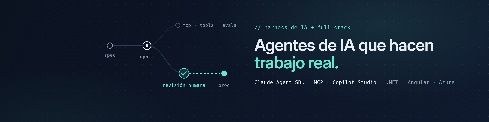

  

## Hola, soy Juanjo

Desarrollador full stack en la Universidad EAFIT, en Medellín. Lo mío es armar el **harness de IA**: todo lo que va alrededor del modelo para que haga trabajo real.

> El modelo es el motor; el harness es el carro. Herramientas y MCP para que el agente pueda hacer cosas, contexto y specs para que sepa qué hacer, permisos para que no se meta donde no debe, evals para saber si sí funciona y un humano en el circuito donde importa.

### En qué ando

- **Asistentes en Microsoft Copilot Studio** para áreas administrativas de la universidad, publicados en Teams: historias de usuario, documentación y evals.
- **Agentes con Claude Agent SDK** para el equipo de desarrollo. Armé el MVP de un worker que documenta repos solito y publica en Azure DevOps, conectado al servidor MCP del equipo.
- **Desarrollo guiado por specs** con OpenSpec y Claude Code en el día a día.

> Ojo pues: ese camello vive en repos privados de la universidad. Lo que hay acá son proyectos personales y de formación.

### Stack

  

**IA y agentes:** Claude Agent SDK · Claude Code · Model Context Protocol (MCP) · Microsoft Copilot Studio · Power Automate

### Proyectos públicos

| Proyecto | Qué es | Stack |
|---|---|---|
| [ecommerce-tennis](https://github.com/Juxnjo/ecommerce-tennis) | E-commerce de productos de tenis, dockerizado y con diagramas de arquitectura | .NET 8 · Angular 18 |
| [Auth-Sales-App](https://github.com/Juxnjo/Auth-Sales-App) | Gestión de productos financieros con auth segura, captcha, dashboard y backoffice | Node.js · PostgreSQL |
| [station-management-system-app](https://github.com/Juxnjo/station-management-system-app) | Administración de estaciones con autenticación y formularios validados | React · Vite |
| [STLPrintBot](https://github.com/e-pasion/STLPrintBot-ProyectoSena) | Cotizador de impresión 3D a partir de archivos STL (proyecto SENA, aporté en el front-end) | JavaScript |

### Hablemos

Escribo sobre agentes de IA, seguridad y desarrollo en [LinkedIn](https://www.linkedin.com/in/juan-jose-ramirez-mejia/), en español y con acento paisa.

English version

Full stack developer at Universidad EAFIT (Medellín, Colombia). I build the **AI harness**: everything around the model that makes it do real work. Tools and MCP, context and specs, permissions, evals and a human in the loop where it matters.

- Microsoft Copilot Studio assistants for the university's administrative areas, published in Teams.
- Claude Agent SDK agents for the dev team, including a living-documentation worker MVP that documents repos and publishes to Azure DevOps.
- Spec-driven development with OpenSpec and Claude Code.

Most of my AI work lives in private university repos; this profile shows personal and training projects.

